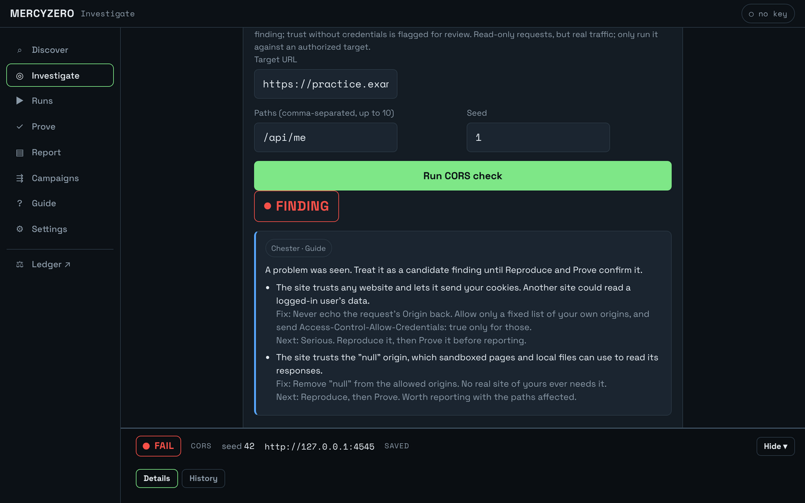
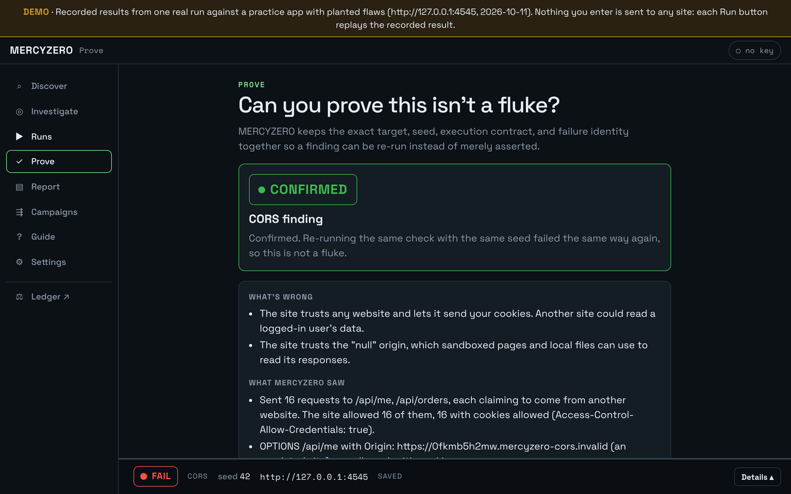
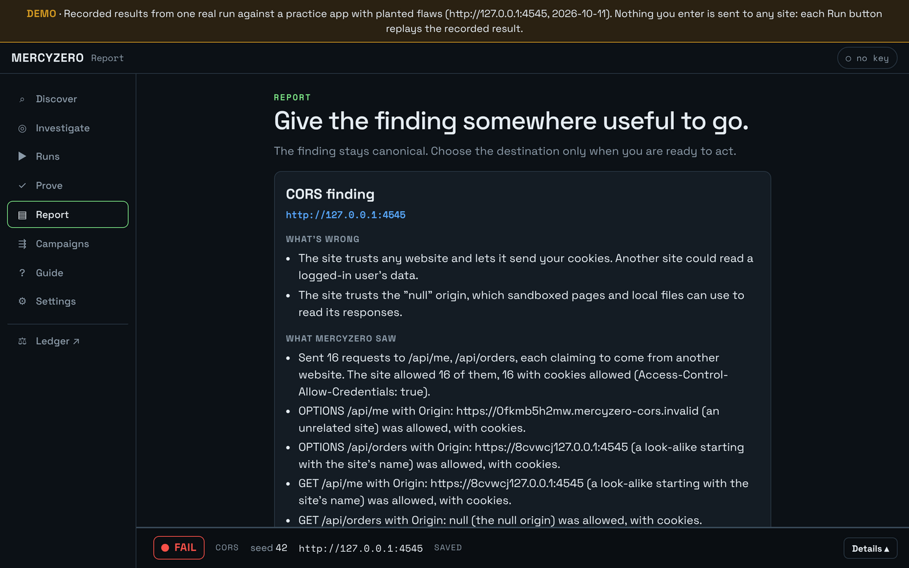
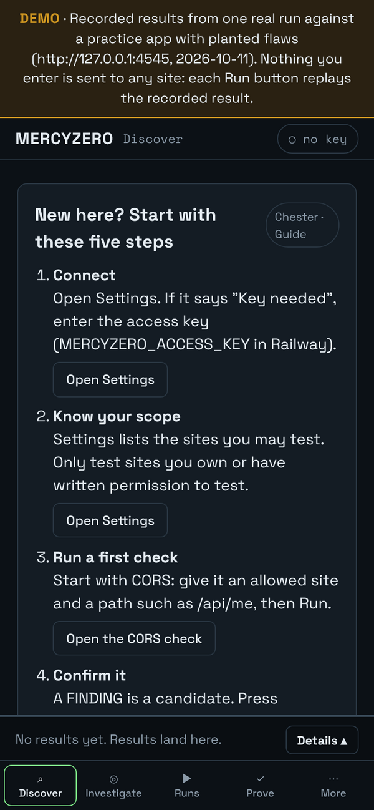
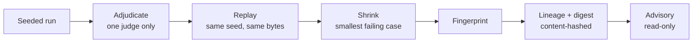

# MERCYZERO

**A deterministic security-testing and evidence platform.**

Most security scanners hand you a list of warnings. MERCYZERO runs a seeded, repeatable check against a site you're allowed to test. A single component decides pass or fail, and then the result has to prove itself: replay it, shrink it, fingerprint it, and write it up with the evidence attached.

> The source code is private. This repo is a public overview. A live demo is linked below, and the code walkthrough is available on request.

**[▶ Try the live demo](https://mercyzero-demo-production.up.railway.app)** · [Full app](https://mercyzero-app-production.up.railway.app) (access key required) · [Portfolio](https://samuel-tuck-portfolio.vercel.app)

---

## See it work

The demo replays one real run against a practice app with flaws planted on purpose. Every button works, and nothing you type is ever sent to a real site.

**1. Run a check.** The CORS check finds that the practice site trusts any website with a user's cookies.

**2. Prove it isn't a fluke.** Reproduce runs the same check with the same seed. Same failure, same fingerprint: confirmed.

**3. Report it.** The write-up is built only from the recorded evidence: what's wrong, what was seen, why it matters, and how to fix it.

The console works on a phone too.

---

## How it works

| Piece | What it does |
|---|---|
| **Engine** | Runs seeded, repeatable checks: CORS, redirects, cookies, rate limits, IDOR, authorization, uploads, SSRF, hardening |
| **cant-touch-this** | The only component allowed to decide pass or fail |
| **Evidence** | Replay, shrink, fingerprint, and lineage, so a finding can be re-run instead of just asserted |
| **Digest** | Content-hashed facts that can't quietly change |
| **Advisory** | Read-only guidance. It can explain, but it never decides, and it takes no free-text input. |
| **Server + console** | Fastify API and a button-only web console that works on mobile |
| **Chaos harness** | Isolated database-branch environment, kept apart from the engine on purpose |

**Stack:** TypeScript (strict), Node.js, Fastify, PostgreSQL, Playwright, Railway. Twelve npm workspaces.

---

## How it's verified

- **1,004 automated tests**: 999 pass, 0 fail, and 5 more run in the database gate. Roughly half the codebase is tests (~17k of ~38k lines).
- **Real-browser tests on every screen.** A headless Chromium run drives the whole console, including this demo.
- **Architecture is enforced, not suggested.** CI fails the build if a module imports something it isn't allowed to.
- **Deploys only on green.** Production ships only after the full gate passes: lockfile, architecture, contracts, build, unit tests, integration tests, and browser tests.
- **The demo can't touch anything.** Demo mode registers no live routes and refuses to start if it sees a database or access key. A test asserts zero network calls.
- **Open risks are written down,** with a plan for each, instead of being left out.

## Defects caught in live use

These came from using the deployed app as a real user would. All three are fixed and verified.

| Severity | Defect |
|---|---|
| High | A check could change data on the site it was testing. A security tool must never modify its target. |
| Medium | The report feature had never produced a working report. |
| Docs | The documentation described behavior the app didn't have. |

---

## How it was built

I built MERCYZERO by steering conversational AI with my own two-layer prompting method, **Goggles & Lens**: *Goggles* set the field and its standards, and *Lens* sets the reasoning perspective. AI agents handled a small share of the implementation. My job was the spec, the gates, and refusing to accept "it works" without proof.

**Samuel Tuck** · AI Evaluation & QA · [Portfolio](https://samuel-tuck-portfolio.vercel.app) · [LinkedIn](https://www.linkedin.com/in/samuel-tuck-441a0b204) · samtuck54@gmail.com
