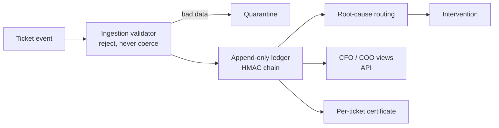

# SLAav

**An SLA authority layer for Zendesk-style support teams.**

When a support SLA is breached, someone pays, and the ticketing platform's own logs can be edited after the fact. SLAav keeps an independent, tamper-evident record of every SLA event. It works out *why* each breach happened, routes a fix, and gives finance and operations a dollar figure they can defend.

> **Status: backend MVP, deployed.** It builds and its full test suite passes. The finance and operations views are API endpoints; the screens come next, once the core has proven itself.
>
> The source code is private. This repo is a public overview, and a walkthrough is available on request. The production instance runs on Railway behind an API key.

[Portfolio](https://samuel-tuck-portfolio.vercel.app)

---

## What it does

| Capability | Detail |
|---|---|
| **Append-only ledger** | A Postgres ledger with an immutability trigger. Any attempt to edit or delete history is rejected by the database itself. |
| **Keyed hash chain** | Every entry is linked to the one before it with HMAC-SHA256. Forging an entry requires the signing key. |
| **Root-cause routing** | Each breach is sorted into one of five causes: Pending State Abuse, Routing Ping-Pong, Triage Delay, Agent Timeout, or System Unavailable. |
| **Interventions** | Each root cause maps to a corrective action and a priority. |
| **CFO view** (API) | Active breaches, total financial exposure, and breakdowns by severity and root cause |
| **COO view** (API) | Operational attribution, time spent in pending, and triage completion |
| **Certificates** | Per-ticket cryptographic proof of the ledger's state |

**Stack:** Python, FastAPI, PostgreSQL, GitHub Actions, Railway.

---

## How it's verified

- **193 tests** run in CI against a live Postgres database, not mocks.
- **The hash chain is checked independently.** A test recomputes each HMAC from scratch and requires an *exact* match with the stored hash. Checking the format alone doesn't count.
- **14 adversarial ingestion tests.** Malformed or hostile data goes to quarantine and is never quietly "fixed up."
- **Load tested against real production, three times.** Database pool use peaked at 90% and 75% under normal settings without tripping the circuit breaker. In a third session the pool was deliberately shrunk to force the breaker open, which confirmed that it degrades gracefully and recovers as designed.
- **Every claim is pinned to a commit and a CI run** in an evidence package.

## Limits, stated openly

Not yet claimed: a production scheduler, an automated repeatable load-test suite, a key-rotation drill, a Bitcoin-confirmed timestamp anchor, a public third-party proof endpoint, or multi-instance high availability.

> *Evidence-first. Claims track commits and CI runs, not intent.*

---

## How it was built

I built SLAav by steering conversational AI with my own prompting method, **Goggles & Lens**, then verifying every claim against tests and CI runs before accepting it.

**Samuel Tuck** · AI Evaluation & QA · [Portfolio](https://samuel-tuck-portfolio.vercel.app) · [LinkedIn](https://www.linkedin.com/in/samuel-tuck-441a0b204) · samtuck54@gmail.com
